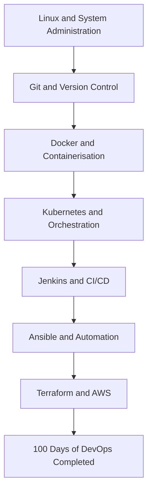
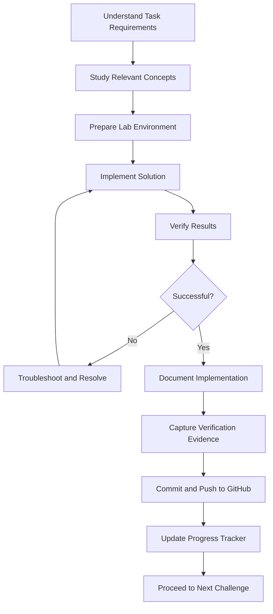

# 🚀 100 Days of DevOps Challenge


## 📖 About This Repository

Welcome to my **100 Days of DevOps Challenge** repository!

This repository documents my 100-day hands-on learning journey
in DevOps, covering Linux system administration, version control,
containerisation, container orchestration, Continuous Integration
and Continuous Delivery (CI/CD), configuration management,
automation and Infrastructure as Code (IaC).

The objective of this challenge is to strengthen my technical
knowledge through practical exercises, real-world scenarios,
troubleshooting and infrastructure automation.

Each day focuses on a specific DevOps task, with documented
implementation steps, commands, configurations, verification
results and key learning takeaways.

This repository serves as both a personal learning journal
and a technical portfolio demonstrating my practical DevOps skills.

---

## 🎯 Learning Objectives

- Develop practical Linux system administration skills.
- Understand networking, permissions and system security.
- Strengthen Git and GitHub version control skills.
- Build, deploy and manage Docker containers.
- Deploy and troubleshoot applications using Kubernetes.
- Implement CI/CD workflows using Jenkins.
- Automate infrastructure and configuration using Ansible.
- Provision and manage cloud resources using Terraform.
- Develop systematic troubleshooting and problem-solving skills.
- Apply DevOps principles through hands-on exercises.
- Build a comprehensive DevOps technical portfolio.

---

## 🛠️ Tools and Technologies


---

## 📊 Challenge Progress

| Metric | Progress |
|---|---|
| Total Challenges | 100 |
| Completed | 0 |
| In Progress | 1 |
| Remaining | 100 |
| Completion Rate | 0% |
| Overall Status | 🟡 In Progress |

**Progress Bar**

`░░░░░░░░░░░░░░░░░░░░` 0%

### Status Legend

- 🟢 Completed
- 🟡 In Progress
- ⚪ Pending

---

## 🗺️ Learning Roadmap

| Phase | Days | Technology | Challenges | Status |
|---|---|---|---:|---|
| 01 | 01–20 | Linux & System Administration | 20 | 🟡 |
| 02 | 21–34 | Git & Version Control | 14 | ⚪ |
| 03 | 35–47 | Docker & Containerisation | 13 | ⚪ |
| 04 | 48–67 | Kubernetes & Orchestration | 20 | ⚪ |
| 05 | 68–81 | Jenkins & CI/CD | 14 | ⚪ |
| 06 | 82–93 | Ansible & Automation | 12 | ⚪ |
| 07 | 94–100 | Terraform & AWS | 7 | ⚪ |
| | | **Total** | **100** | |

---

## 🏗️ DevOps Learning Journey



---

## 📂 Repository Structure

```text
100-days-of-devops/
│
├── README.md
├── .gitignore
│
├── 01-Linux/
│   ├── Day-001/
│   ├── Day-002/
│   └── ... Day-020/
│
├── 02-Git/
│   ├── Day-021/
│   └── ... Day-034/
│
├── 03-Docker/
│   ├── Day-035/
│   └── ... Day-047/
│
├── 04-Kubernetes/
│   ├── Day-048/
│   └── ... Day-067/
│
├── 05-Jenkins/
│   ├── Day-068/
│   └── ... Day-081/
│
├── 06-Ansible/
│   ├── Day-082/
│   └── ... Day-093/
│
└── 07-Terraform/
    ├── Day-094/
    └── ... Day-100/
```

Each daily challenge may contain:

```text
Day-XXX/
├── README.md
├── scripts/
├── configs/
├── manifests/
└── screenshots/
```

Files and directories will be added as required for each challenge.

---

## 📅 100 Days of DevOps — Challenge Tracker

### Phase 1: Linux & System Administration

**Days 01–20**

Focus areas:

- Linux user and group management
- File ownership and permissions
- SSH authentication and security
- SELinux
- Cron job scheduling
- Bash scripting
- Network services and firewall configuration
- Web servers and load balancing
- Database administration
- SSL/TLS configuration
- Service and process troubleshooting

| Day | Challenge | Status |
|---|---|---|
| 01 | Linux User Setup with Non-Interactive Shell | 🟡 |
| 02 | Temporary User Setup with Expiry | ⚪ |
| 03 | Secure Root SSH Access | ⚪ |
| 04 | Script Execution Permissions | ⚪ |
| 05 | SELinux Installation and Configuration | ⚪ |
| 06 | Create a Cron Job | ⚪ |
| 07 | Linux SSH Authentication | ⚪ |
| 08 | Install Ansible | ⚪ |
| 09 | MariaDB Troubleshooting | ⚪ |
| 10 | Linux Bash Scripts | ⚪ |
| 11 | Install and Configure Tomcat Server | ⚪ |
| 12 | Linux Network Services | ⚪ |
| 13 | IPtables Installation and Configuration | ⚪ |
| 14 | Linux Process Troubleshooting | ⚪ |
| 15 | Setup SSL for Nginx | ⚪ |
| 16 | Install and Configure Nginx as an LBR | ⚪ |
| 17 | Install and Configure PostgreSQL | ⚪ |
| 18 | Install and Configure DB Server | ⚪ |
| 19 | Install and Configure Web Application | ⚪ |
| 20 | Configure Nginx + PHP-FPM Using Unix Sock | ⚪ |

---

### Phase 2: Git & Version Control

**Days 21–34**

Focus areas:

- Git repository management
- Bare repositories
- Cloning and forking
- Branching and merging
- Remote repository management
- Pull requests and code reviews
- Git revert and reset
- Cherry-picking
- Git stash and rebase
- Merge conflict resolution
- Git hooks

| Day | Challenge | Status |
|---|---|---|
| 21 | Set Up Git Repository on Storage Server | ⚪ |
| 22 | Clone Git Repository on Storage Server | ⚪ |
| 23 | Fork a Git Repository | ⚪ |
| 24 | Git Create Branches | ⚪ |
| 25 | Git Merge Branches | ⚪ |
| 26 | Git Manage Remotes | ⚪ |
| 27 | Git Revert Some Changes | ⚪ |
| 28 | Git Cherry Pick | ⚪ |
| 29 | Manage Git Pull Requests | ⚪ |
| 30 | Git Hard Reset | ⚪ |
| 31 | Git Stash | ⚪ |
| 32 | Git Rebase | ⚪ |
| 33 | Resolve Git Merge Conflicts | ⚪ |
| 34 | Git Hook | ⚪ |

---

### Phase 3: Docker & Containerisation

**Days 35–47**

Focus areas:

- Docker installation and configuration
- Container lifecycle management
- Docker images and image tagging
- Container file operations
- Dockerfile development
- Docker networking
- Port mapping
- Persistent storage and volume mounting
- Docker Compose
- Multi-container applications
- Application containerisation
- Docker troubleshooting

| Day | Challenge | Status |
|---|---|---|
| 35 | Install Docker Packages and Start Docker Service | ⚪ |
| 36 | Deploy Nginx Container on Application Server | ⚪ |
| 37 | Copy File to Docker Container | ⚪ |
| 38 | Pull Docker Image | ⚪ |
| 39 | Create a Docker Image From Container | ⚪ |
| 40 | Docker EXEC Operations | ⚪ |
| 41 | Write a Dockerfile | ⚪ |
| 42 | Create a Docker Network | ⚪ |
| 43 | Docker Ports Mapping | ⚪ |
| 44 | Write a Docker Compose File | ⚪ |
| 45 | Resolve Dockerfile Issues | ⚪ |
| 46 | Deploy an App on Docker Containers | ⚪ |
| 47 | Docker Python App | ⚪ |

---

### Phase 4: Kubernetes & Container Orchestration

**Days 48–67**

Focus areas:

- Kubernetes Pods and Deployments
- Labels and selectors
- Resource requests and limits
- Rolling updates and rollbacks
- Kubernetes Services
- NodePort and ClusterIP
- Shared volumes and volume mounts
- Persistent Volumes and Persistent Volume Claims
- Sidecar and init containers
- Environment variables
- ConfigMaps and Secrets
- Multi-tier application deployments
- Kubernetes troubleshooting

| Day | Challenge | Status |
|---|---|---|
| 48 | Deploy Pods in Kubernetes Cluster | ⚪ |
| 49 | Deploy Applications with Kubernetes Deployments | ⚪ |
| 50 | Set Resource Limits in Kubernetes Pods | ⚪ |
| 51 | Execute Rolling Updates in Kubernetes | ⚪ |
| 52 | Revert Deployment to Previous Version in Kubernetes | ⚪ |
| 53 | Resolve VolumeMounts Issue in Kubernetes | ⚪ |
| 54 | Kubernetes Shared Volumes | ⚪ |
| 55 | Kubernetes Sidecar Containers | ⚪ |
| 56 | Deploy Nginx Web Server on Kubernetes Cluster | ⚪ |
| 57 | Print Environment Variables | ⚪ |
| 58 | Deploy Grafana on Kubernetes Cluster | ⚪ |
| 59 | Troubleshoot Deployment Issues in Kubernetes | ⚪ |
| 60 | Persistent Volumes in Kubernetes | ⚪ |
| 61 | Init Containers in Kubernetes | ⚪ |
| 62 | Manage Secrets in Kubernetes | ⚪ |
| 63 | Deploy Iron Gallery App on Kubernetes | ⚪ |
| 64 | Fix Python App Deployed on Kubernetes Cluster | ⚪ |
| 65 | Deploy Redis Deployment on Kubernetes | ⚪ |
| 66 | Deploy MySQL on Kubernetes | ⚪ |
| 67 | Deploy Guest Book App on Kubernetes | ⚪ |

---

### Phase 5: Jenkins & CI/CD Pipelines

**Days 68–81**

Focus areas:

- Jenkins installation and configuration
- Plugin management
- User authentication and authorisation
- Freestyle jobs
- Parameterised builds
- Scheduled jobs
- Database backup automation
- Jenkins agents and distributed builds
- Project-based security
- Pipeline development
- Conditional pipelines
- Automated application deployment
- Chained builds
- Multistage pipelines

| Day | Challenge | Status |
|---|---|---|
| 68 | Set Up Jenkins Server | ⚪ |
| 69 | Install Jenkins Plugins | ⚪ |
| 70 | Configure Jenkins User Access | ⚪ |
| 71 | Configure Jenkins Job for Package Installation | ⚪ |
| 72 | Jenkins Parameterized Builds | ⚪ |
| 73 | Jenkins Scheduled Jobs | ⚪ |
| 74 | Jenkins Database Backup Job | ⚪ |
| 75 | Jenkins Slave Nodes | ⚪ |
| 76 | Jenkins Project Security | ⚪ |
| 77 | Jenkins Deploy Pipeline | ⚪ |
| 78 | Jenkins Conditional Pipeline | ⚪ |
| 79 | Jenkins Deployment Job | ⚪ |
| 80 | Jenkins Chained Builds | ⚪ |
| 81 | Jenkins Multistage Pipeline | ⚪ |

---

### Phase 6: Ansible & Configuration Management

**Days 82–93**

Focus areas:

- Ansible inventory management
- SSH connectivity
- Ansible ad hoc commands
- YAML playbook development
- File and directory management
- Package installation
- Service management
- Idempotency
- Access Control Lists (ACLs)
- Jinja2 templating
- Variables and facts
- Conditional execution

| Day | Challenge | Status |
|---|---|---|
| 82 | Create Ansible Inventory for App Server Testing | ⚪ |
| 83 | Troubleshoot and Create Ansible Playbook | ⚪ |
| 84 | Copy Data to App Servers Using Ansible | ⚪ |
| 85 | Create Files on App Servers Using Ansible | ⚪ |
| 86 | Ansible Ping Module Usage | ⚪ |
| 87 | Ansible Install Package | ⚪ |
| 88 | Ansible Blockinfile Module | ⚪ |
| 89 | Ansible Manage Services | ⚪ |
| 90 | Managing ACLs Using Ansible | ⚪ |
| 91 | Ansible Lineinfile Module | ⚪ |
| 92 | Managing Jinja2 Templates Using Ansible | ⚪ |
| 93 | Using Ansible Conditionals | ⚪ |

---

### Phase 7: Terraform & AWS Infrastructure as Code

**Days 94–100**

Focus areas:

- Infrastructure as Code principles
- Terraform configuration and HCL
- Terraform providers and resources
- Variables and outputs
- Terraform workflow
- AWS Virtual Private Cloud (VPC)
- AWS Security Groups
- Amazon EC2
- AWS Identity and Access Management (IAM)
- Amazon DynamoDB
- Amazon CloudWatch
- Amazon SNS

| Day | Challenge | Status |
|---|---|---|
| 94 | Create VPC Using Terraform | ⚪ |
| 95 | Create Security Group Using Terraform | ⚪ |
| 96 | Create EC2 Instance Using Terraform | ⚪ |
| 97 | Create IAM Policy Using Terraform | ⚪ |
| 98 | Launch EC2 in Private VPC Subnet Using Terraform | ⚪ |
| 99 | Attach IAM Policy for DynamoDB Access Using Terraform | ⚪ |
| 100 | Create and Configure Alarm Using CloudWatch Using Terraform | ⚪ |

---

## 📝 Daily Challenge Documentation

Each challenge will follow a consistent documentation format
to ensure that the implementation is clear, reproducible
and easy to reference.

### Documentation Template

| Section | Description |
|---|---|
| Challenge Title | Name of the daily challenge |
| Objective | Purpose of the exercise |
| Task Requirements | Technical requirements and expected outcomes |
| Prerequisites | Required tools, access and environment |
| Concepts | Explanation of relevant technical concepts |
| Implementation | Step-by-step implementation |
| Commands | Commands and their explanations |
| Configuration | Scripts, manifests and configuration files |
| Verification | Commands and results confirming task completion |
| Troubleshooting | Issues encountered and resolutions |
| Screenshots | Evidence of successful implementation |
| Key Takeaways | Knowledge and skills gained |
| References | Relevant technical documentation |
| Status | Completion status of the challenge |

---

## 🔄 Daily Learning Workflow



---

## 💻 Getting Started

### Prerequisites

Depending on the challenge, the following tools and
environments may be required:

- Linux virtual machine or cloud-based lab environment
- Terminal and SSH client
- Git and GitHub account
- Docker Engine and Docker Compose
- Kubernetes cluster and kubectl
- Jenkins server
- Ansible control node
- Terraform CLI
- AWS account or AWS lab environment
- Code editor such as Visual Studio Code

### Clone This Repository

```bash
git clone https://github.com/YOUR_USERNAME/100-days-of-devops.git
```

Navigate to the repository:

```bash
cd 100-days-of-devops
```

Explore the daily challenge directories and follow the
documented implementation steps.

---

## 🔧 Git Commit Convention

Meaningful commit messages will be used throughout this
challenge to maintain a clear and consistent commit history.

### Examples

```text
Day 001: Complete Linux user setup
Day 002: Configure temporary user expiry
Day 003: Disable direct root SSH login
Day 035: Install and configure Docker
Day 048: Deploy Kubernetes pod
Day 068: Configure Jenkins server
Day 082: Create Ansible inventory
Day 094: Provision AWS VPC using Terraform
```

### Daily Git Workflow

```bash
# Check repository status
git status

# Stage changes
git add .

# Commit daily progress
git commit -m "Day XXX: Challenge description"

# Push changes to GitHub
git push origin main
```

---

## 🔐 Security and Best Practices

Throughout this challenge, the following practices
will be applied where appropriate:

- Follow the principle of least privilege.
- Use secure SSH authentication.
- Avoid hardcoding credentials in scripts.
- Never commit passwords, tokens or private keys.
- Use environment variables and secret management.
- Apply appropriate file ownership and permissions.
- Validate configurations before deployment.
- Verify infrastructure changes after implementation.
- Use version control to track configuration changes.
- Practise infrastructure automation and idempotency.
- Review Terraform plans before applying changes.
- Remove unused cloud resources to avoid unnecessary costs.
- Perform potentially disruptive exercises only in isolated
  lab environments.

Sensitive information will be removed from screenshots,
configuration files and command outputs before publication.

---

## 🏆 Challenge Milestones

- [ ] Day 010 — First 10 DevOps challenges completed
- [ ] Day 020 — Linux and System Administration completed
- [ ] Day 034 — Git and Version Control completed
- [ ] Day 047 — Docker and Containerisation completed
- [ ] Day 050 — Halfway through the challenge
- [ ] Day 067 — Kubernetes and Orchestration completed
- [ ] Day 081 — Jenkins and CI/CD completed
- [ ] Day 093 — Ansible and Automation completed
- [ ] Day 100 — Terraform and AWS completed
- [ ] 100 Days of DevOps Challenge completed

---

## 🎓 Expected Learning Outcomes

By completing this challenge, I aim to develop practical
experience in:

### System Administration

- Managing Linux users, permissions and services.
- Configuring secure remote access.
- Troubleshooting operating system and network issues.
- Configuring web servers and databases.

### Version Control

- Managing Git repositories and branches.
- Resolving merge conflicts.
- Understanding collaborative development workflows.
- Maintaining structured version control history.

### Containerisation and Orchestration

- Building and managing container images.
- Deploying multi-container applications.
- Managing Kubernetes workloads and services.
- Troubleshooting containerised applications.

### Continuous Integration and Continuous Delivery

- Configuring Jenkins jobs and pipelines.
- Automating application deployments.
- Managing build agents and access permissions.
- Implementing deployment and validation stages.

### Configuration Management

- Developing reusable Ansible playbooks.
- Automating server configuration.
- Managing packages, files and services.
- Applying templates and conditional execution.

### Cloud and Infrastructure as Code

- Provisioning AWS infrastructure using Terraform.
- Managing networking and security resources.
- Understanding IAM permissions and policies.
- Configuring cloud monitoring and notifications.

---

## 📚 Learning Resources

Official documentation and technical references:

| Technology | Documentation |
|---|---|
| Linux | [Linux Documentation](https://docs.kernel.org/) |
| Red Hat | [Red Hat Documentation](https://docs.redhat.com/) |
| Bash | [GNU Bash Manual](https://www.gnu.org/software/bash/manual/) |
| Git | [Git Documentation](https://git-scm.com/doc) |
| GitHub | [GitHub Docs](https://docs.github.com/) |
| Docker | [Docker Documentation](https://docs.docker.com/) |
| Kubernetes | [Kubernetes Documentation](https://kubernetes.io/docs/) |
| Jenkins | [Jenkins Documentation](https://www.jenkins.io/doc/) |
| Ansible | [Ansible Documentation](https://docs.ansible.com/) |
| Terraform | [HashiCorp Terraform Documentation](https://developer.hashicorp.com/terraform/docs) |
| AWS | [AWS Documentation](https://docs.aws.amazon.com/) |
| Nginx | [Nginx Documentation](https://nginx.org/en/docs/) |
| PostgreSQL | [PostgreSQL Documentation](https://www.postgresql.org/docs/) |
| Grafana | [Grafana Documentation](https://grafana.com/docs/) |

---

## ⚠️ Disclaimer

This repository is intended for educational purposes
and hands-on DevOps learning.

All exercises are intended to be performed in controlled
lab environments. Configurations and commands may require
modification before use in production environments.

Some exercises involve legacy software versions,
security configuration changes or destructive Git operations
for learning purposes. These should not be treated as
production security recommendations.

The challenge roadmap follows the 100 Days of DevOps
learning material, while the implementation notes,
scripts and troubleshooting records will document
my own practical learning journey.

---

## 🤝 Feedback and Contributions

Feedback, suggestions and technical discussions are welcome.

If you identify an alternative approach, improvement
or correction, feel free to open an issue or start
a discussion.

---

## ⭐ Connect and Follow My Journey

This repository will be updated progressively as I complete
each challenge and continue developing my DevOps skills.

If you find this repository useful, feel free to give it
a star and follow my learning journey.

---

**100 Days. 100 Challenges. Continuous Learning.**

*Learning by doing, one challenge at a time.*

#100DaysOfDevOps #DevOps #Linux #Git #Docker #Kubernetes
#Jenkins #Ansible #Terraform #AWS #CloudComputing
#InfrastructureAsCode #CICD #Automation
